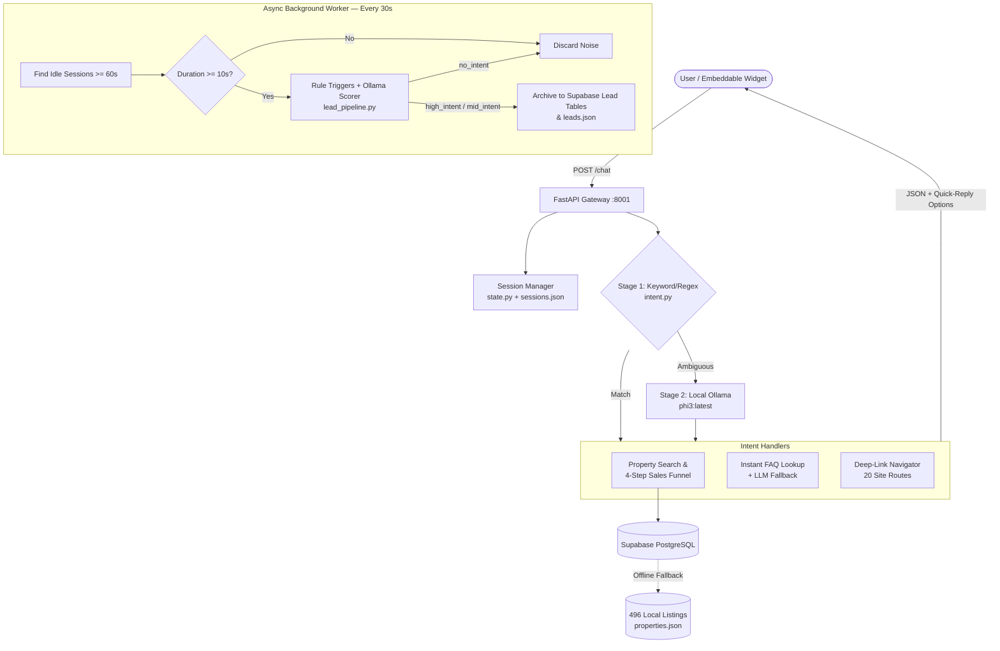

<div align="center">

# 🏠 Property Doors AI Chatbot `v2.0`

### **Real Estate Assistant & Autonomous Lead-Scoring Engine**

*Bridging the gap between casual property browsing and high-intent sales conversions — without pure-LLM latency, hallucinations, or single-point database failures.*

[](https://www.python.org/)
[](https://fastapi.tiangolo.com/)
[](https://ollama.com/)
[](https://supabase.com/)

[The Problem](#-the-problem) •
[Key Differentiators](#-key-differentiators) •
[Demo Video](#-demo-video) •
[Live Preview](#-live-flow-preview) •
[Tech Stack](#-tech-stack) •
[Architecture](#-system-architecture) •
[Getting Started](#-getting-started--testing) •
[Engineering Highlights](#-key-engineering-highlights)

</div>

---

> [!TIP]
> **30-Second TL;DR:** Property Brix combines **instant deterministic routing** (greetings, FAQs, 20+ site routes, NLP search) with a **local Ollama (`phi3:latest`) fallback**, a **4-step guided sales funnel**, and an **autonomous 30s background worker** that scores idle sessions into `high_intent` / `mid_intent` leads in Supabase—falling back seamlessly to **496 local JSON listings** if the database is offline.

| ⚡ `0` LLM Calls | 🏘️ `496` Listings | 🧭 `20` Deep Links | 🤖 `30s` Lead Worker | 🔒 `1h` Session TTL |
| :---: | :---: | :---: | :---: | :---: |
| For Stage-1 FAQs, nav & regex search | Offline-ready JSON catalog fallback | Instant site navigation routes | Polls sessions idle `>= 60s` | Disk-persisted, lock-protected state |

---

## 🎯 The Problem

Real estate platforms lose high-intent buyers every day to two broken chatbot patterns:

| Approach | Typical Failure Mode | **Property Brix Hybrid Solution** |
| :--- | :--- | :--- |
| **Rigid FAQ Bots** | Trapped in menus; drop users who type natural queries | Parses *"2 BHK in Pune under 80 lakh"* in **one turn** or guides via funnel |
| **Pure LLM Wrappers** | High latency, API cost per greeting, inventory hallucinations | **Stage-1 deterministic router** handles common intents at zero LLM cost |
| **Passive Chat Widgets** | Wait for users to fill out a form; casual browsers vanish | **Background AI worker** scores behavior & archives `high_intent` leads |
| **Single-DB Backends** | Crash or return empty results if remote DB is unreachable | **Dual-persistence layer** falls back to local `properties.json` & locked JSON |

---

## ⚡ Key Differentiators

- **Two-Stage Hybrid Intent Engine (`intent.py`):**
  - **Stage 1 (Instant):** Keyword & regex matching routes greetings, gratitude, 20 site navigation links, FAQs, and property queries immediately.
  - **Stage 2 (Semantic Fallback):** Only ambiguous natural language reaches local **Ollama (`phi3:latest`)** via async REST (`/api/generate`).
- **One-Shot NLU + Guided 4-Step Funnel (`property_search.py`, `state.py`):**
  - Users can click through `Purpose ➔ Location ➔ Property Type ➔ Budget` **or** type a full sentence to short-circuit the funnel and get matched listings immediately.
- **Autonomous Lead-Scoring Pipeline (`lead_pipeline.py`, `intent_classifier.py`):**
  - Every **30 seconds**, an `asyncio` worker inspects sessions idle **≥ 60 seconds** (discarding noise under `10s`).
  - Combines deterministic high-intent triggers (site visits, callbacks, booking process, unit availability, budget, home loans/EMI) with LLM scoring to classify `high_intent`, `mid_intent`, or `no_intent`.
- **Fail-Safe Dual Persistence (`supabase_service.py`, `storage.py`):**
  - Queries **Supabase** PostgreSQL in real time and logs leads via a service-role admin client; automatically falls back to thread-safe, `threading.Lock`-protected JSON files when offline.
- **2-Line Drop-In Widget (`chatbot-embed.js`):**
  - Served directly from `/widget.js` with behavioral tracking (`/track-activity`), enquiry submission (`/enquire`), and Supabase Auth demo pages.

---

## 🎬 Demo Video

<div align="center">
  <video src="assets/Property_Doors_AI_Demo.mp4" controls width="100%">
    <a href="assets/Property_Doors_AI_Demo.mp4">▶️ Watch Property Doors AI Demo</a>
  </video>
</div>

> 🎥 **[Watch / Download Demo Video (`Property_Doors_AI_Demo.mp4`)](assets/Property_Doors_AI_Demo.mp4)**

---

## 💬 Live Flow Preview

```text
👤 User: "I want a 2 BHK in Pune under 80 lakh"
🤖 Bot:  [Stage-1 NLP Parser] → Extracts { location: "Pune", bedrooms: 2, max_price: 0.80 Cr }
         → Queries Supabase (or 496-property JSON fallback) → Returns matched listings + quick actions!

👤 User: "Can I schedule a site visit this weekend?"
🤖 Bot:  [Answers & prompts for visit details]

⏱️ 60s of inactivity later... (Background Worker wakes up)
🧠 Lead Pipeline: Deterministic trigger ("site visit") + Ollama Scorer
   → Archives structured lead to Supabase `high_intent_leads` & `lead_conversations`:
```

```json
{
  "lead_classification": "high_intent",
  "classification_reason": "User requested a site visit - direct purchase action signal.",
  "time_spent_seconds": 95,
  "pages_navigated": ["/properties", "/pune-2bhk"],
  "questions_asked": ["Can I schedule a site visit this weekend?"]
}
```

---

## 🛠️ Tech Stack

| Layer | Technologies |
| :--- | :--- |
| **Backend API** | Python 3.8+, FastAPI `0.111.0`, Uvicorn `0.29.0`, Pydantic `2.7.1`, `httpx`, `python-dotenv` |
| **Local AI / LLM** | [Ollama](https://ollama.com/) (`phi3:latest` via REST API) |
| **Database & Auth** | [Supabase](https://supabase.com/) (`supabase==2.4.6` PostgreSQL + Service Role client, Supabase JS v2 Auth) |
| **Offline Resilience** | `threading.Lock` file-locked JSON stores + 496-listing local catalog (`properties.json`) |
| **Frontend** | Vanilla JS embeddable widget (`chatbot-embed.js`), HTML5/CSS3 (`demo.html`, `login.html`, `signup.html`) |
| **Dev Tooling** | GNU `Makefile`, Swagger/OpenAPI (`/docs`), ReDoc (`/redoc`) |

---

## 🏗️ System Architecture

The backend runs **two coordinated workflows**: a real-time **Chat & Search Pipeline** and an asynchronous **Background Lead Qualification Pipeline**.



> Full layer diagrams and user-journey specs are available in [ARCHITECTURE.md](ARCHITECTURE.md) and [WORKFLOWS.md](WORKFLOWS.md).

<details>
<summary><b>📁 Click to expand Project Structure</b></summary>

```text
propertybrix-chatbot/
├── backend/
│   ├── app/
│   │   ├── main.py                 # FastAPI app, 6 endpoints, & 30s background worker
│   │   ├── intent.py               # Two-stage hybrid intent classifier
│   │   ├── intent_classifier.py    # Deterministic + LLM lead intent scorer
│   │   ├── lead_pipeline.py        # Lead qualification, transcript builder & archiving
│   │   ├── llm_client.py           # Async Ollama REST client (/api/generate)
│   │   ├── property_search.py      # NLP query parser (BHK, city, ₹ Lakh/Cr) & filter
│   │   ├── faq_rag.py              # Instant config.json FAQ lookup + LLM fallback
│   │   ├── navigation.py           # Deep-link router for 20 platform pages
│   │   ├── state.py                # Stateful session & 4-step funnel manager (1h TTL)
│   │   ├── storage.py              # Thread-safe, lock-protected JSON persistence
│   │   ├── supabase_client.py      # Supabase anon & service-role client setup
│   │   ├── supabase_service.py     # Remote DB queries, logging & lead tables
│   │   ├── models.py               # Pydantic request/response schemas
│   │   └── data/
│   │       ├── config.json         # FAQs, company metadata & configuration
│   │       ├── properties.json     # 496-property local catalog fallback
│   │       └── *.json              # Persisted sessions, leads, enquiries, interactions
│   └── requirements.txt
├── frontend/
│   ├── chatbot-embed.js            # Lightweight 2-line embeddable chat widget
│   ├── demo.html                   # Interactive widget playground
│   ├── login.html                  # Supabase Auth login demo
│   └── signup.html                 # Supabase Auth signup demo
├── ARCHITECTURE.md                 # Detailed system design & layer diagrams
├── WORKFLOWS.md                    # Step-by-step user journeys & edge cases
└── Makefile                        # venv, install, start, clean automation
```

</details>

---

## 🚀 Getting Started & Testing

### Prerequisites
- **Python 3.8+**
- **[Ollama](https://ollama.com/)** running locally:
  ```bash
  ollama pull phi3:latest
  ollama serve
  ```
- *(Optional)* A **Supabase** project — if omitted, the app automatically runs on its local JSON catalog and storage.

### Quick Start

1. **Create virtual environment & install dependencies:**
   ```bash
   make venv
   make install
   ```
   *(Or manually: `python -m venv backend/venv` and `pip install -r backend/requirements.txt`)*

2. **Configure environment variables** in `backend/.env`:
   ```env
   OLLAMA_BASE_URL=http://localhost:11434
   LLM_MODEL=phi3:latest
   SUPABASE_URL=https://your-project.supabase.co
   SUPABASE_KEY=your-anon-key
   SUPABASE_SERVICE_ROLE_KEY=your-service-role-key
   ```

3. **Start the FastAPI server (port `8001`):**
   ```bash
   make start
   ```
   *(Or from `backend/`: `uvicorn app.main:app --reload --port 8001`)*

4. **Open in Browser:**
   - **Live Widget Playground:** `http://localhost:8001/`
   - **Interactive Swagger Docs:** `http://localhost:8001/docs`
   - **Embeddable Widget Script:** `http://localhost:8001/widget.js`

<details>
<summary><b>🧪 Click to expand API Test Commands (curl) & Widget Embed Snippet</b></summary>

```bash
# 1. Health Check
curl http://localhost:8001/health

# 2. Natural-Language Property Search (short-circuits the 4-step funnel)
curl -X POST http://localhost:8001/chat \
  -H "Content-Type: application/json" \
  -d '{"session_id": "test_01", "message": "I want a 2 BHK in Pune under 80 lakh"}'

# 3. Instant FAQ Lookup
curl -X POST http://localhost:8001/chat \
  -H "Content-Type: application/json" \
  -d '{"session_id": "test_01", "message": "How do I apply for a home loan?"}'

# 4. Deep-Link Site Navigation
curl -X POST http://localhost:8001/chat \
  -H "Content-Type: application/json" \
  -d '{"session_id": "test_01", "message": "Take me to the post property page"}'

# 5. Submit a Property Enquiry
curl -X POST http://localhost:8001/enquire \
  -H "Content-Type: application/json" \
  -d '{"session_id": "test_01", "name": "Demo User", "email": "demo@example.com", "phone": "9999999999", "property_id": "prop_1", "message": "Schedule a site visit"}'
```

**Embed on any HTML page:**
```html
<script>
  window.CHATBOT_CONFIG = {
    apiUrl: "http://localhost:8001",
    companyName: "Property Brix",
    primaryColor: "#4ADE80"
  };
</script>
<script src="http://localhost:8001/widget.js" defer></script>
```

</details>

---

## 👨‍💻 Key Engineering Highlights

- **Hybrid Intent & NLU Pipeline (`intent.py`, `property_search.py`):** Built a two-stage router that resolves common queries deterministically in milliseconds and parses Indian real estate phrasing (`BHK`, `Lakh`, `Crore`, cities, property types) before falling back to Ollama.
- **Stateful Sales Funnel (`state.py`):** Implemented disk-persisted session state with a 1-hour TTL so users never lose context across server restarts, seamlessly advancing through `purpose ➔ location ➔ property_type ➔ budget`.
- **Autonomous Lead-Scoring Worker (`main.py`, `lead_pipeline.py`, `intent_classifier.py`):** Engineered an `asyncio` polling worker, deterministic high-intent trigger rules, structured JSON LLM evaluation, and automatic Supabase archiving into `lead_conversations`, `high_intent_leads`, and `mid_intent_leads`.
- **Fault-Tolerant Storage Layer (`supabase_service.py`, `storage.py`):** Designed dual-mode persistence with `threading.Lock` file protection and a 496-listing local JSON fallback so the chatbot stays 100% operational even if external services go down.
- **Embeddable Frontend & Auth Flow (`chatbot-embed.js`, `demo.html`, `login.html`, `signup.html`):** Built a zero-dependency floating chat widget with quick-reply buttons, behavioral activity tracking (`/track-activity`), and Supabase Auth integration.
